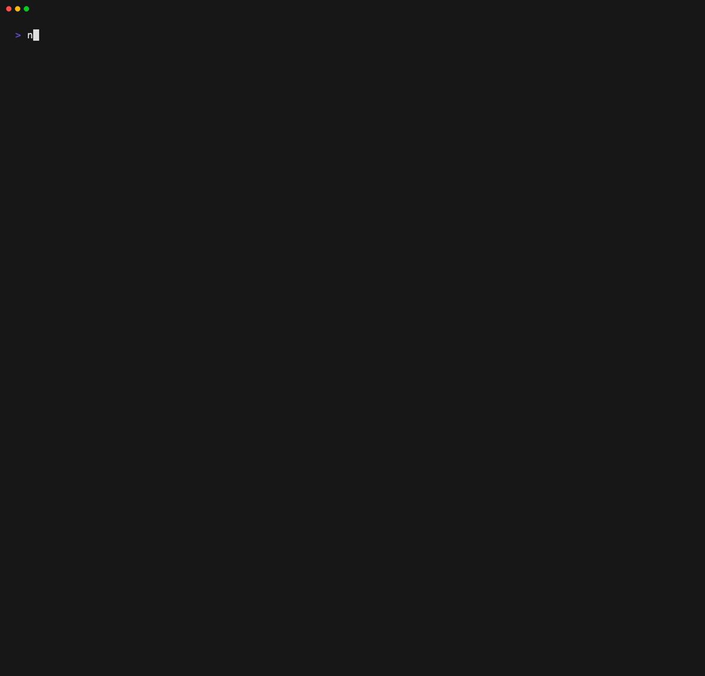
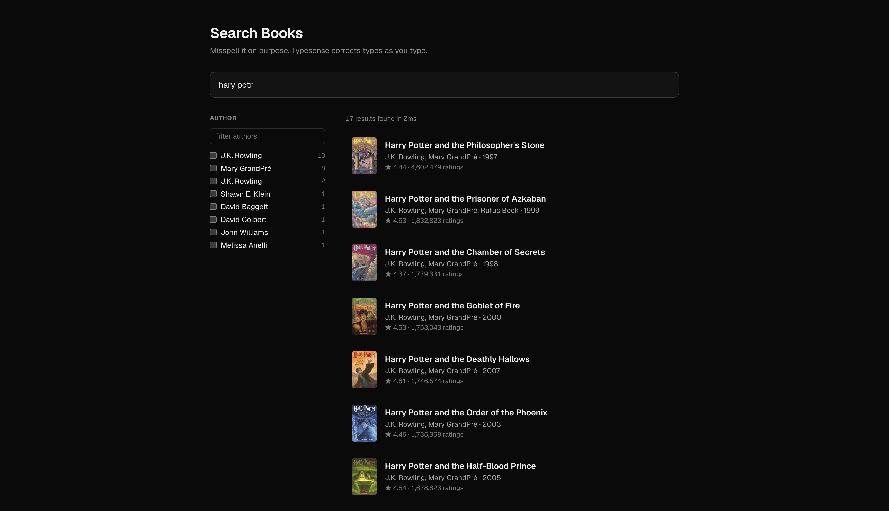

# create-typesense-app <a href="https://npmjs.com/package/create-typesense-app"></a>

The fastest way to try Typesense: a working search UI on your data, in your framework, in one command.

```bash
npx create-typesense-app@latest my-search-app --yes
```



The generated app, searching the misspelled "hary potr":



You need Node.js 22 or later. Docker is optional. Without Docker, you point the
CLI at a Typesense server that you already run, self-hosted or on Typesense
Cloud.

The CLI supports Next.js, React, Vue, SvelteKit, Angular, SolidJS, Qwik, and
plain JavaScript. To see every flag, run `npx create-typesense-app@latest --help`.

## Run it from an AI agent

The prompts need an interactive terminal, so an agent runs the CLI with `--yes`
and flags.

To start a local demo, make sure that Docker runs, then run:

```bash
npx create-typesense-app@latest my-search-app --yes -t nextjs
```

Typesense starts in a container and indexes about 10,000 books.

To search the user's own server, the server's admin key must already be in the
`TYPESENSE_API_KEY` environment variable. Then run:

```bash
npx create-typesense-app@latest my-search-app --yes -t nextjs \
  --server-url https://xyz.a1.typesense.net --collections products
```

- Never put the key on the command line. To pipe it in, add `--api-key-stdin`.
- Never ask the user to paste the key into the chat. Ask them to set
  `TYPESENSE_API_KEY` in their own shell.
- `-t` takes a template id: `nextjs`, `angular`, `qwik`, `react`, `solid`,
  `sveltekit`, `vanilla`, or `vue`.
- Without `--collections`, the CLI uses every collection and alias on the server.
- The CLI uses the admin key for this run only, to create a search-only key for the
  browser. It writes only that search-only key to the project.

With `--yes`, the CLI does not start the dev server. When it finishes, run
`cd my-search-app && npm run dev`.

## Try Typesense with sample data

The local demo runs Typesense in Docker and indexes about 10,000 books, so you
can see typo tolerance on real titles.

1. Start the CLI:

   ```bash
   npm create typesense-app@latest
   ```

2. Enter a directory name and choose a framework.
3. At **Typesense server?**, choose **Spin one up locally with Docker**.
4. When the CLI finishes, it starts the dev server and opens the page in your
   browser. Type `hary potr`.
5. To stop the dev server, press Ctrl+C. To start it again later, run
   `cd my-search-app && npm run dev`.

The page opens with the most-rated books. The misspelled query finds Harry
Potter.

To skip the prompts, pass a directory and `--yes`. With `npm create`, put `--`
before the flags:

```bash
npm create typesense-app@latest my-search-app -- --yes
```

If port 8108 is in use, the CLI tells you before it downloads or writes
anything. It offers the next free port, or the Typesense server that already
runs there.

The project gets three npm scripts:

| Script | What it does |
|---|---|
| `npm run seed` | Recreates the collection from `typesense.config.json`, imports `data/books.jsonl` again, and makes a new search key if the old one is gone. |
| `npm run typesense:up` | Starts the Typesense container. |
| `npm run typesense:down` | Stops the container. The indexed data stays. To delete it too, run `docker compose down --volumes`. |

## Search your own Typesense server

The CLI builds the same UI over the collections on a server that you already
run, self-hosted or Typesense Cloud. It does not need Docker.

The CLI asks for the server's admin key. It uses that key for this run only: to
read the schemas, and to create one search-only key for the browser, scoped to
the collections that you choose. The admin key is not saved anywhere. The CLI
changes nothing else on the server. A second run in the same directory replaces
its own search-only key, and leaves every other key alone.

1. Start the CLI:

   ```bash
   npx create-typesense-app@latest my-search-app
   ```

2. At **Typesense server?**, choose **I already have one running** or
   **Typesense Cloud**.
3. Enter the server URL, then paste the admin key. The key prompt hides what you
   type. If Typesense refuses the key, the CLI says so and asks again. To stop,
   press Ctrl+C.
4. Select the collections and aliases to search. Each one shows its document
   count.
5. Review the search config for each collection, or change it. The config says
   which fields the page searches, facets, and shows.
6. The CLI starts the dev server and opens the page in your browser.

To skip the key prompt, set `TYPESENSE_API_KEY` to the admin key, or pass
`--api-key-stdin`.

With one collection, the home page searches that collection, with its facets.
With several, one query goes to all of them. Each collection gets a section with
its top 5 hits and a **Show all in &lt;collection&gt;** link to its own page.

## Change what the page searches and shows

Edit `typesense.config.json` in the project root. Each collection has a `search`
entry:

```json
"search": {
  "queryBy": ["name", "director"],
  "facets": ["genres"],
  "title": "name",
  "image": null,
  "display": ["director", "genres", "year"]
}
```

| Field | Description |
|---|---|
| `queryBy` | Fields that a query searches. |
| `facets` | Fields that get a filter list on the left. |
| `title` | The field that titles each hit, with the matches highlighted. |
| `image` | The field that holds an image URL, or `null` for no image. |
| `display` | Fields shown under the title, as `Label: value`. |

Restart the dev server to see the change. If a field name is wrong, the page
shows the error from Typesense instead of an empty list.

The CLI writes the file only if the project has none, so your edits survive a
second run. It fills in `search` from the schema and from 10 sample documents:

- `queryBy` gets every indexed `string` and `string[]` field, except the image.
- `facets` gets the `queryBy` fields that have `facet: true`. A number field
  never becomes a facet, because most of its values have one document each.
- `title` gets the first `queryBy` field whose name contains `title` or `name`.
- `image` gets the first `string` field whose name contains `image`,
  `thumbnail`, or `photo`.
- `display` gets every other field.

For the local demo, the `schema` entry in the same file defines the collection.
To rebuild the collection after you change it, run `npm run seed`.

## The env file

The CLI writes the connection values to the env file that the framework reads,
for example `.env.local` for Next.js. A variable with the framework's public
prefix, for example `NEXT_PUBLIC_`, reaches the browser.

| Variable | Public prefix | Value |
|---|---|---|
| `TYPESENSE_HOST`, `TYPESENSE_PORT`, `TYPESENSE_PROTOCOL` | yes | Where the server is. |
| `TYPESENSE_COLLECTION` | yes | The first collection. |
| `TYPESENSE_SEARCH_ONLY_API_KEY` | yes | The key the browser searches with. The CLI creates it, scoped to `documents:search` on your collections. |
| `TYPESENSE_API_KEY` | never | The admin key. Local server only: an existing server's admin key is never written. Only `npm run seed` reads it. |

If the starter's `.gitignore` does not cover the env file, the CLI adds it.

## Add a framework

A template is a manifest and a set of files, so a new framework needs no change
to the CLI. Follow [Add a template](templates/adding-a-template.md).
